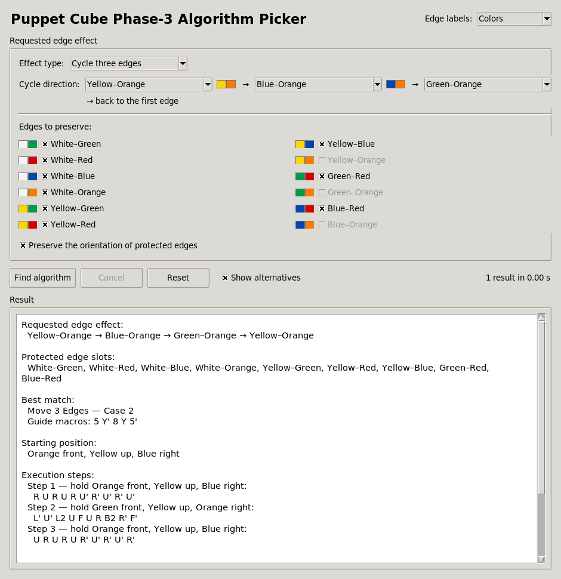
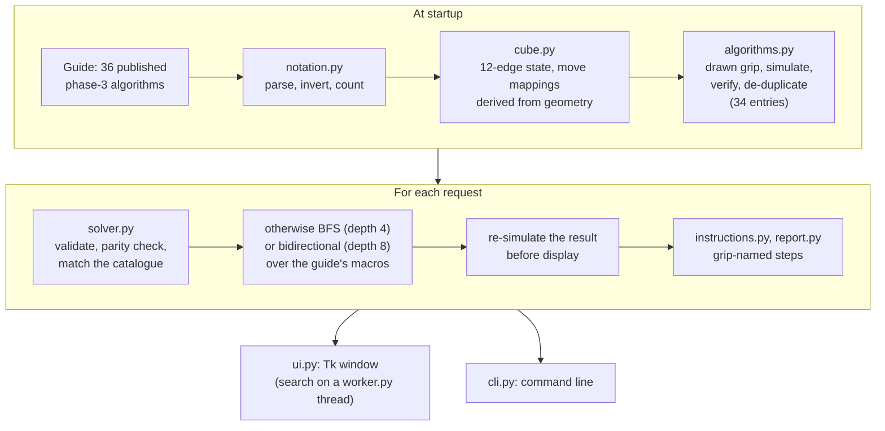

# Puppet Cube Solver: phase-3 edge algorithms

[](https://github.com/AlphaShk/puppet-cube-solver/actions/workflows/ci.yml)


A phase-3 edge-algorithm picker for the Puppet Cube (V1), not a full solver.
For a requested edge swap, 3-cycle or flip it picks a published algorithm
whose effect is verified in simulation. When no published case fits, it builds
one from the guide's macros with bounded breadth-first and meet-in-the-middle
search. Pure standard-library Python, with a Tk window and a command-line
interface: the package `puppet_edge_picker` installs the `puppet-edge-picker`
(window) and `puppet-edge-picker-cli` commands.



## What and why

The **Puppet Cube** (V1) is a 3x3x3 shape mod in which several pieces are
fused into larger blocks. A face turn can therefore drag one or two layers of
the hidden mechanism, and an algorithm only works from the grip it was
designed for.

The phase-3 section of a
[Puppet Cube guide](https://mrlhumphreys.github.io/twisty_guide_j/guides/puppet-cube-phase-3)
solves the edges with 36 published algorithms. Using them means knowing which
one produces the effect in front of you, how to hold the cube, and what to do
when none of them fits. This tool answers all three. It simulates every
published algorithm and matches the requested effect against the verified
results. If nothing matches, it searches combinations of the guide's macros.
Either way it prints the moves grip by grip.

## Key results

Every figure here is printed by `python scripts/coverage.py` (coverage,
slowest requests, face turns) or `python scripts/search_sizes.py`
(generators, state counts), and unit tests pin the catalogue counts, the
generators and the first four search layers. Timings are local measurements
on an Apple M5 with Python 3.14.

- **Bounded search with checked answers.** Requests that no published case
  answers go to a search over the 14 distinct effects of the guide's macros:
  breadth-first up to four macros (30,419 states), or, for exact flips, a
  bidirectional search that reaches eight macros while holding at most
  60,838 states, where a one-way search would need 3,830,186 states by six
  macros. The slowest request in the families below, an eight-macro exact
  flip, takes about half a second. Every answer is re-simulated move by move
  before it is shown, and the code passes `mypy --strict`.
- **Coverage of complete request families:**

  | Request family | Requests | From catalogue | By macro search | Unanswered | of which name DR/DB/BR | Answered on the 9 movable edges |
  |---|---:|---:|---:|---:|---:|---:|
  | Flip two edges in place | 66 | 8 | 28 | 30 | 30 | 36 of 36 |
  | Swap one pair, nothing protected | 66 | 8 | 28 | 30 | 30 | 36 of 36 |
  | Directed 3-cycle, nothing protected | 440 | 10 | 158 | 272 | 272 | 168 of 168 |
  | Directed 3-cycle, all other edges protected | 440 | 10 | 72 | 358 | 272 | 82 of 168 |
  | Two swaps, all other edges protected | 1485 | 0 | 49 | 1436 | 1107 | 49 of 378 |

  No published case or macro moves the DR, DB or BR edge, so requests that
  name one of them are impossible, not cut off by the search bounds. On the
  other nine edges, every exact two-edge flip, every single swap and every
  unprotected 3-cycle is answered. When every other edge must stay in place,
  the remaining 3-cycles and double swaps match no published case and no
  combination of up to four macros.
- **Cost per request family** (slowest request over two runs):

  | Request family | Slowest request | Face turns, catalogue answers | Face turns, search answers |
  |---|---:|---:|---:|
  | Flip two edges in place | 0.49 to 0.53 s (8 macros) | 80 to 100 | 40 to 80 |
  | Swap one pair, nothing protected | 0.02 s | 20 | 20 to 40 |
  | Directed 3-cycle, nothing protected | 0.08 s | 10 to 50 | 20 to 40 |
  | Directed 3-cycle, all other edges protected | 0.12 to 0.15 s | 10 to 50 | 30 to 40 |
  | Two swaps, all other edges protected | 0.09 to 0.13 s | - | 40 |

- **Responsive window.** The search runs on a worker thread that the window
  polls, so the window keeps handling events. Cancel, Reset or closing the
  window stops the search.
- **96 unit tests** cover the cube model, notation, catalogue, solver, search
  space, cancellation, worker thread, report, CLI and window. CI runs them on
  Python 3.11 to 3.14, with the window tests under a virtual display, plus
  ruff and `mypy --strict`.

## How it works



1. **Edge-only state model.** A state is a permutation of the 12 edge pieces
   (which piece sits in each slot) plus a 0/1 flip per slot, held in an
   immutable, validated dataclass. Corners are not modelled, because every
   request is about edges.
2. **Move mappings from geometry.** Each face has an outward unit vector `a`.
   A clockwise quarter turn is a rotation by -90 degrees about `a`, which for
   integer vectors reduces Rodrigues' formula to `v' = -(a × v) + a (a · v)`.
   Applying it to both faces of every edge slot gives the new slot and the new
   sticker orientation, so no move table is typed by hand. A wide turn moves
   everything except the opposite layer. X/Y/Z rotations relabel slots and
   pieces together, because they are regrips, not puzzle moves.
3. **Puppet blocks as hidden wide turns.** For the eight base macros the
   simulation uses wide-turn equivalents (for example `Rw` where the guide
   shows `R`) that reproduce the edge cycles drawn in the guide's diagrams.
   The moves shown to the user stay exactly as published.
4. **Verified catalogue.** The 36 algorithms are 8 base macros, their 8
   reverses (derived by inversion), 8 "move 3 edges" compositions, 4 pair
   swaps and 8 two-edge flips. Each one is conjugated into one of the two
   grips the guide draws (`Y X2` or `Z2`), returned to the original colour
   frame, simulated and compared by effect. Case 7 has the same edge effect
   as the reverse of Case 8, and the reverse of Case 7 the same as Case 8, so
   de-duplication by effect leaves 34 catalogue entries. Cases are never
   re-gripped, because the fused blocks make rotated equivalents mechanically
   invalid.
5. **Request validation and parity.** Every macro permutes edges in a 5-cycle
   or a 3-cycle, so every reachable state is an even permutation. A request
   with an odd number of swaps therefore needs at least two unprotected edges
   that the macros can move (DR, DB and BR never move) to absorb a
   compensating transposition. Otherwise it is rejected before any search,
   like conflicting or incomplete requests. Requests that would move DR, DB
   or BR are answered at once.
6. **Bounded search.** If no catalogue entry matches, breadth-first search
   combines the 16 base and reverse macros (14 distinct effects) up to depth
   4, with a 250,000-state cap. It composes effects as permutations with
   XOR'd flips instead of re-simulating moves. An exact two-edge flip fully
   determines the target state, so for flips the tool uses bidirectional
   search from solved and from the target, up to a combined depth of 8. That
   finds, for example, a 6-macro, 60-face-turn flip of UB and FR. Results are
   ranked by face turns, macro count, rotations and length, with published
   cases before synthesized ones.
7. **Verification before display.** Catalogue matches are re-simulated move
   by move before they are shown. Every synthesized sequence is expanded,
   simulated and checked against the predicted effect.
8. **Grip instructions.** X/Y/Z tokens become named grips such as "Orange
   front, Yellow up, Blue right", and each run of face turns between regrips
   becomes a numbered step.
9. **Responsive window.** A `SearchWorker` thread runs the search and the
   window polls for the outcome with `after()`, so the Tk event loop never
   blocks. Cancel, Reset or closing the window sets a flag that the solver
   checks once per expanded state.

[docs/design.md](docs/design.md) covers the conventions, the search sizes and
the trade-offs in more detail.

## Quickstart

```bash
git clone https://github.com/AlphaShk/puppet-cube-solver.git
cd puppet-cube-solver
python3 -m venv .venv && source .venv/bin/activate
python -m pip install .

puppet-edge-picker                                  # open the window
puppet-edge-picker-cli cycle DL BL FL --preserve-rest
```

Installing is optional. From the repository root,
`python -m puppet_edge_picker` opens the window and
`python -m puppet_edge_picker.cli ...` runs the CLI.
There are no runtime dependencies. Tkinter ships with the python.org
installers; on Debian or Ubuntu install `python3-tk`, and with Homebrew
install `python-tk@3.x`. The CLI works without Tk. Without tkinter, or
without a display, the window command prints a hint instead of a traceback
and exits with status 1.

## Example

Cycle three edges while every other edge stays in place and unflipped:

```text
$ puppet-edge-picker-cli cycle DL BL FL --preserve-rest
Requested edge effect:
  Yellow–Orange → Blue–Orange → Green–Orange → Yellow–Orange

Protected edge slots:
  White–Green, White–Red, White–Blue, White–Orange, Yellow–Green, Yellow–Red, Yellow–Blue, Green–Red, Blue–Red

Best match:
  Move 3 Edges — Case 2
  Guide macros: 5 Y' 8 Y 5'

Starting position:
  Orange front, Yellow up, Blue right

Execution steps:
  Step 1 — hold Orange front, Yellow up, Blue right:
    R U R U R U' R' U' R' U'
  Step 2 — hold Green front, Yellow up, Orange right:
    L' U' L2 U F U R B2 R' F'
  Step 3 — hold Orange front, Yellow up, Blue right:
    U R U R U R' U' R' U' R'

Actual edge permutation:
  Yellow–Orange → Blue–Orange → Green–Orange → Yellow–Orange
Moved edge slots:
  Yellow–Orange, Green–Orange, Blue–Orange
Flipped edge slots:
  None
Face-turn count: 30
Grip changes: 2
```

The commands are `swap A B [C D]`, `cycle A B C`, `flip A B` and `catalogue`.
`swap` and `cycle` accept `--preserve EDGE ...`, `--preserve-rest` and
`--ignore-orientation`. `swap`, `cycle` and `flip` accept `--labels faces`,
`--alternatives`, `--catalogue-only` and `--timeout SECONDS`. Edges can be
given as face letters (`UF` or `FU`), colour initials (`WG`) or colour names
(`white-green`), using the colour scheme U White, D Yellow, F Green, B Blue,
R Red, L Orange. The exit status is 0 when an algorithm was found, 1 when
nothing matches within the bounds, 2 for an invalid request and 3 when the
search stopped (state cap or timeout).

## Project structure

```text
puppet_edge_picker/
  notation.py      move parser (also the guide's R^{2} spelling), inversion, counts
  settings.py      edge slots, colour scheme, labels
  cube.py          immutable edge state, move mappings from geometry, 24 orientations
  algorithms.py    transcribed guide cases, grips, compile/verify/de-duplicate
  solver.py        validation, parity, matching, BFS and bidirectional search
  instructions.py  rotations to named grips and execution steps
  report.py        plain-text report shared by the window and the CLI
  worker.py        background search thread with cancellation
  ui.py, main.py   Tk window and its entry point (puppet-edge-picker)
  cli.py           command-line interface (puppet-edge-picker-cli)
scripts/coverage.py      reproduces the coverage and cost tables above
scripts/search_sizes.py  reproduces the generator and state counts
tests/                   96 unittest tests
docs/design.md           conventions, search sizes and design notes
```

## Tests and CI

```bash
python -m unittest -v                      # 96 tests
python scripts/coverage.py                 # coverage and cost tables, under a minute
python scripts/search_sizes.py             # search-space sizes, a few seconds
python -m pip install -r requirements-dev.txt && ruff check . && mypy
```

Six window tests use a real, withdrawn Tk window, for example to check that
Cancel, Reset and closing the window stop a running search. They skip when
tkinter is missing, or on Linux when no display is set; CI runs the suite
under `xvfb-run`, so they run there too. A seventh test only imports the
window module, and two more check the hint the window command prints when
tkinter is missing or Tk cannot open a window.

## Limitations

- It covers phase 3 of one guide for the Puppet Cube V1. It is not a full
  solver: corners are not modelled, and it never searches arbitrary face
  turns. That is deliberate, because only the verified macros keep the solved
  blocks intact.
- The search is bounded. "No match" for a request on the nine movable edges
  means no published case and no combination within four macros (eight for
  exact flips). It does not prove the effect impossible.
- A published case always wins. When one matches, no search runs, even if a
  combination with fewer face turns might exist.
- Verification is against the simulation model. The base macros' edge cycles
  are unit-tested against the guide's diagrams, but the fused blocks are not
  modelled physically.
- Results chain whole 10-turn macros, so they are long: the best results in
  the coverage families run from 10 to 100 face turns, and synthesized ones
  from 20 to 80. They are not move-optimal.
- Desktop only: the interface is Tk, with no web build.

## Credits

The move sequences of the 36 phase-3 algorithms are transcribed from the
Puppet Cube (V1) phase-3 page of the
[Twisty Puzzle Guide](https://mrlhumphreys.github.io/twisty_guide_j/guides/puppet-cube-phase-3)
by mrlhumphreys ([source repository](https://github.com/mrlhumphreys/twisty_guide_j)).
Entries keep the guide's section names and case numbers so each one can be
looked up there; no other text and no diagrams are reproduced. The MIT
license covers the code in this repository, not the published algorithms,
and credit for those belongs to the guide's author.

## License

[MIT](LICENSE) © 2026 Denys Shkola
